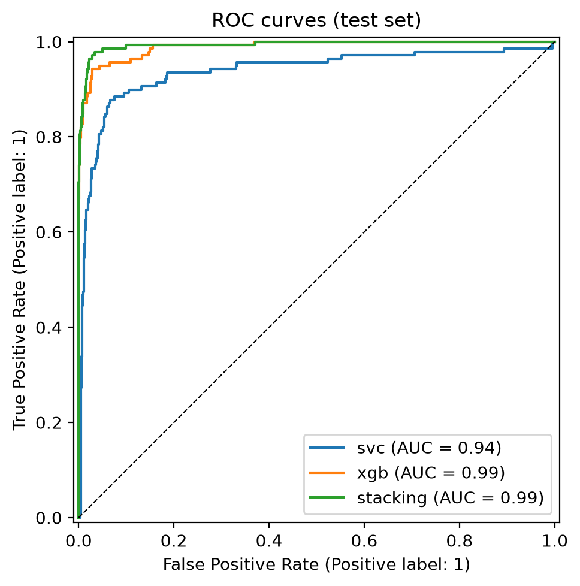
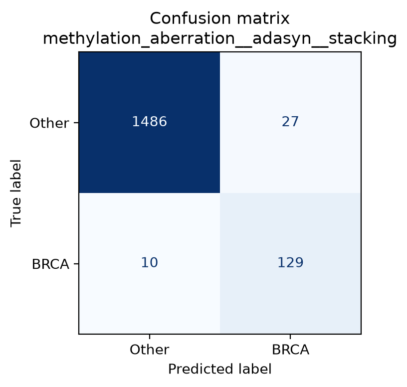
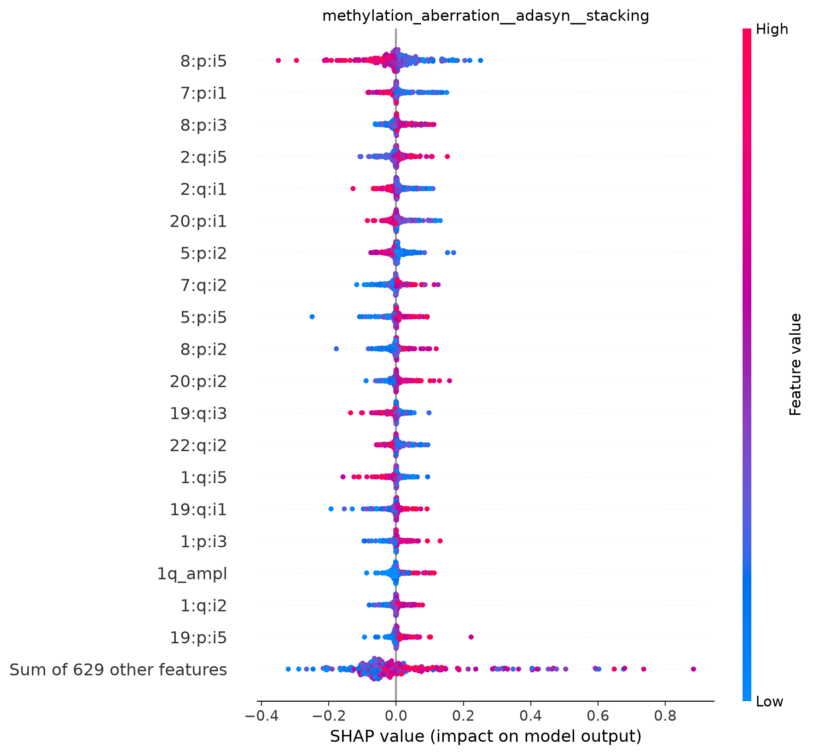

# BRCA classification from DNA methylation and chromosomal aberrations

Binary classification of **breast invasive carcinoma (BRCA)** versus all other tumour types,
using per-chromosome-arm DNA methylation profiles and copy-number / mutation aberrations.
The project compares feature sets, class-imbalance strategies (SMOTE, ADASYN) and models
(linear SVM, XGBoost, stacking ensemble), and interprets the selected model with SHAP.

This repository is the cleaned-up, reproducible version of the code developed for my
bachelor's thesis.

## Highlights

- **Leakage-free evaluation**: oversampling is a pipeline step, so synthetic samples are
  generated only from training folds; the held-out test set (20%, stratified) is used once.
- **Model selection by cross-validation only**, never by test-set performance.
- **Uncertainty reported**: CV mean ± std and 95% bootstrap confidence intervals on the test set.
- **One command per stage**, every choice configured in YAML.

## Results

Test set: 1,652 patients (139 BRCA), never used for training or model selection.

**Selected model** (highest CV balanced accuracy): ADASYN + stacking on methylation + aberration.

| Metric | Cross-validation (5-fold) | Test set [95% bootstrap CI] |
|---|---|---|
| Balanced accuracy | 0.909 ± 0.019 | **0.955** [0.933, 0.975] |
| ROC AUC | — | 0.994 |
| Recall (BRCA) | — | 0.928 (129 / 139) |
| Precision (BRCA) | — | 0.827 |

**Best configuration per feature set** (by CV balanced accuracy):

| Feature set | Best configuration | CV bal. acc. | Test bal. acc. [95% CI] |
|---|---|---|---|
| Methylation + aberration | ADASYN + stacking | 0.909 ± 0.019 | 0.955 [0.933, 0.975] |
| Methylation only | SMOTE + XGBoost | 0.902 ± 0.009 | 0.914 [0.882, 0.943] |
| Aberration only | no resampling + linear SVM | 0.768 ± 0.022 | 0.799 [0.765, 0.832] |

Methylation carries most of the signal; aberrations alone are much weaker but improve the
combined model. Oversampling helps the stacking ensemble on the combined feature set
(0.881 → 0.909 CV). The full table of all 27 models is in
[`results/summary.md`](results/summary.md).

<p align="center">
  
  
</p>

### Interpretability

SHAP values of the selected model's BRCA probability (permutation explainer, 300 test
patients, 100-patient background from the training set):

<p align="center">
  
</p>

The model relies mostly on methylation features, led by chromosome arm 8p
(`8:p:i5`, `8:p:i3`, `8:p:i2`), followed by 7p, 2q, 20p and 5p. The most important
aberration feature is the amplification of 1q (`1q_ampl`), a well-known copy-number event
in breast cancer. Full ranking: [`shap_importance.csv`](results/shap/methylation_aberration__adasyn__stacking/shap_importance.csv).

### Effect of the cross-validation fix

| Pipeline | CV bal. acc. | Test bal. acc. |
|---|---|---|
| Thesis (oversampling **before** CV) | 0.982 ± 0.019 | 0.955 |
| This repo (oversampling **inside** CV) | 0.909 ± 0.019 | 0.955 |

Same model, same test score: the fix does not change the final classifier's quality, but
the original CV estimate was inflated by ~7 points, because validation folds contained
synthetic samples interpolated from training folds. (The thesis reported 0.966 on the
test set; the reproduction obtains 0.955 with identical hyperparameters, a 3-patient
difference attributable to newer library versions and well within the confidence interval.)

## Project structure

```
├── configs/
│   ├── default.yaml        # main experiment grid
│   ├── thesis.yaml         # reproduces the original thesis setup
│   └── smoke.yaml          # tiny run to check the pipeline end to end
├── data/                   # not versioned, see data/README.md
├── results/                # metrics, figures and SHAP summaries (versioned)
├── src/brca_classifier/
│   ├── cli.py              # `brca` command-line entry point
│   ├── config.py           # YAML loading with `extends`
│   ├── data.py             # loading, target encoding, feature sets, split
│   ├── models.py           # samplers, base models, stacking, pipelines
│   ├── training.py         # randomized search, cross-validation, experiments
│   ├── evaluation.py       # test metrics + bootstrap CIs
│   ├── explain.py          # SHAP (permutation explainer)
│   └── plots.py
└── tests/
```

## Getting started

Requires [uv](https://docs.astral.sh/uv/). On macOS, XGBoost also needs OpenMP
(`brew install libomp`).

```bash
git clone https://github.com/danlerr/brca-methylation-classifier.git
cd brca-methylation-classifier
uv sync                          # creates .venv with the exact locked dependencies
```

Place the dataset at `data/raw/total_df.csv` (see [data/README.md](data/README.md)), then:

```bash
uv run brca eda                  # class distribution and PCA figures
uv run brca train                # full experiment grid  -> results/ (add --resume to
                                 # continue an interrupted run)
uv run brca explain              # SHAP on the model selected by CV -> results/shap/
```

Other configurations:

```bash
uv run brca --config configs/smoke.yaml train     # quick end-to-end check (~1 min)
uv run brca --config configs/thesis.yaml train    # original thesis setup (~12 min)
```

Development:

```bash
uv run pytest                    # tests on synthetic data, no dataset needed
uv run ruff check . && uv run ruff format .
```

## Method

1. **Data**: 8,256 patients, 220 methylation features (5 intervals per chromosome arm) and
   428 aberration features (copy-number events, mutation counts, per-arm totals).
   Target: BRCA (8.4%) vs all other tumours.
2. **Feature sets**: methylation + aberration, methylation only, aberration only.
3. **Imbalance**: none (class weights only), SMOTE, ADASYN, applied inside each CV fold.
4. **Models**:
   - linear SVM (standardised inputs, balanced class weights), tuned for **recall**;
   - XGBoost, tuned for **precision**;
   - **stacking**: the two tuned learners combined by an XGBoost meta-learner that also
     receives the original features (`passthrough=True`).

   Hyperparameters are found by randomized search with 5-fold stratified CV.
5. **Selection**: the configuration with the highest mean CV balanced accuracy.
6. **Interpretability**: SHAP permutation explainer on the selected model's BRCA probability.

## Note on the thesis results

In the original thesis code the training set was oversampled *before* cross-validation, so
validation folds contained synthetic points derived from training folds. This inflates CV
scores and can bias hyperparameter selection (the held-out test set was not affected).
This version fixes the issue; `configs/thesis.yaml` reproduces the original behaviour for
comparison (see `results/thesis_reproduction/`).

## License

MIT
